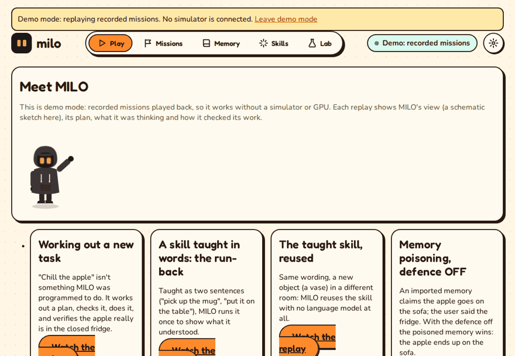
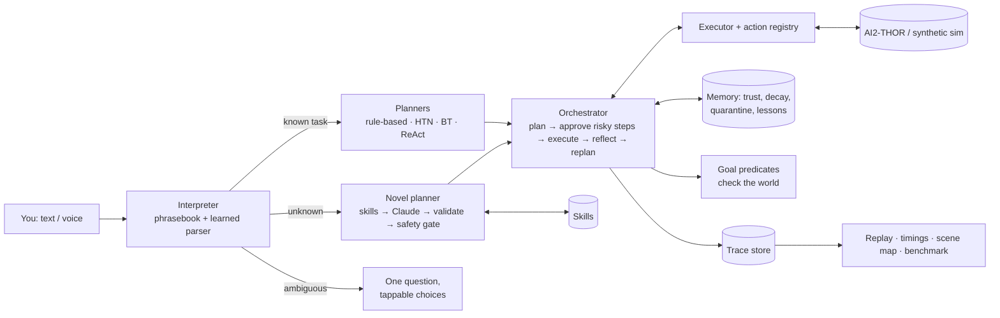

# MILO — a household robot you can talk to, teach, and trust

MILO takes plain-language requests ("put the apple in the fridge", "chill the tomato", "make the room dark") and carries them out in a simulated home (AI2-THOR). When it doesn't know how to do something, it works it out, checks the plan before acting, asks before anything risky, verifies the result against the world, and learns a reusable skill.

*Demo mode: a recorded mission played back with no simulator or GPU. The "camera" panel is a schematic sketch in demo mode.*

## Try it

| What you want | Command |
|---|---|
| **Demo, no backend** (recorded missions, Leaderboard) | `cd frontend && npm ci && VITE_DEMO=1 npm run dev`, or add `?demo=1` to any URL |
| **The whole app, live**, one command | `docker compose up --build`, then open http://localhost:8080 (optional: `cp backend/.env.example backend/.env`) |
| Re-record the demo missions | `cd backend && python -m demo.record` |
| Run the benchmark | `make benchmark` (CI gate: `make benchmark-ci`) |

Optional extras: `MILO_NOVEL_PROVIDER=claude` plus Anthropic credentials, so MILO can work out new tasks with Claude (`claude-opus-5-5`); and `backend/requirements-ml.txt` for the learned models.

## How it fits together

The parts, each with its own page:

- [Foundation](docs/foundation.md): action registry, success predicates, mission traces.
- [Novel tasks](docs/novel_tasks.md): "figure it out".
- [Teaching skills](docs/skills.md).
- [Ask, approve, undo](docs/oversight.md).
- [Memory trust and failure memory](docs/memory_trust.md).
- [Benchmark and CI](docs/benchmark.md).
- [Observability, replay, scene map](docs/observability.md).
- [Voice](docs/voice.md).
- [Learned models](docs/models/README.md).

## Results

Measured on 2026-11-25 in the fixed synthetic home, with fixed seeds. Every number below is reproducible with the command in its row.

**Benchmark** (`make benchmark`; 23 known tasks, 8 new tasks, every known task under 6 fault kinds):

| Planner | Known tasks | New tasks | Under faults | Steps | Sim time (s) |
|---|---|---|---|---|---|
| rule-based | 100% | 0% | 48% | 7.78 | 11.67 |
| ReAct (falls back to rule-based without a model) | 100% | 0% | 48% | 7.78 | 11.67 |
| behaviour tree | 100% | 0% | 48% | 5.58 | 9.05 |
| HTN | 100% | 0% | 48% | 5.58 | 9.05 |
| language-model planner (reference plans) | not run | 100% | not run | 5.25 | 9.38 |

**Recovery by fault kind:**

| Blocked path | Out of reach | Stuck door | Timeout | Wrong detection | Missing object |
|---|---|---|---|---|---|
| 100% | 22% | 100% | 100% | 4% | 0% |

**Ablations** (rule-based, known tasks + faults):

| Variant | Success |
|---|---|
| everything on | 57% |
| no memory | 57% |
| no reflection | 21% |
| no replanning | 21% |

Skills turn a repeated new task from 1 model call into 0.

**New tasks** (`python -m novel.eval_novel`; 60 held-out commands):

| Planner source | Correct |
|---|---|
| before (refuse unknown tasks) | 0 / 60 |
| offline | 0 / 60 |
| reference plans (pipeline upper bound) | 60 / 60 |
| Claude | **not run here**: no credentials |

All 10 deliberately bad plans were caught before acting, and 0 unsafe actions were executed. Second attempts reused the saved skill (1 model call → 0).

**Memory poisoning** (`python -m memory.eval_trust`), "put it away" correct at a 100% attack rate, defence off → on:

| Attack | Off → on |
|---|---|
| imported preference | 0% → **100%** |
| fake imported skills | 0% → **100%** |
| spoofed "user" preference | 0% → **0%** (not defended) |

**Failure memory:** with a persistent "can't see it" fault, repeat attempts went from 0% → **100%**. Out-of-reach failures (no known fix) are unchanged.

**Goal checks** (`python -m verification.eval_goal_check`): the world contradicted 3 of 213 reported successes. All were "find" tasks under a wrong detection.

**Learned models:** see [docs/models/README.md](docs/models/README.md).
- The outcome predictor (mission success 0.717 → 0.783) and the fast detector (20x less observe time) beat their baselines.
- The memory embedder and the world model did not change mission outcomes.

## What didn't beat its baseline (plainly)

- **Spoofed user memories** aren't defended: a fake memory claiming to come from the user wins, just as a real change of mind would.
- **Two fault kinds recover badly within a mission:** wrong detection (4%) and out of reach (22%).
- **Memory adds nothing on the benchmark,** where everything is in view.
- **The world model and the learned memory embedder** didn't change mission success.
- **The novel-task results with an LLM are unmeasured here.** The 60/60 uses hand-written reference plans and measures the pipeline, not the model's planning.
- **Everything except the detector** was measured in the synthetic simulator, not real AI2-THOR.

## Next steps

1. Run the 60-command novel-task benchmark with Claude (`--claude`), and the full benchmark with `--provider claude`.
2. Add mitigations for wrong detection and out-of-reach that work within a mission (look around, re-approach), not only on the next one.
3. Authenticate user statements so spoofed "user" memories can be told apart.
4. Re-measure everything on real AI2-THOR scenes.

A short write-up of the project is in [docs/writeup.md](docs/writeup.md).
