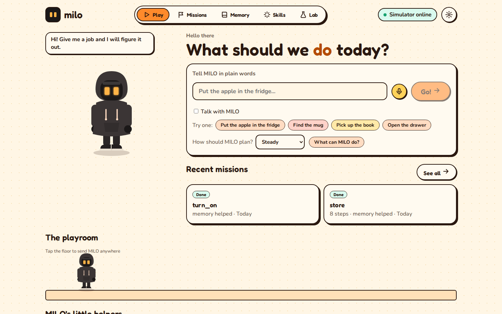
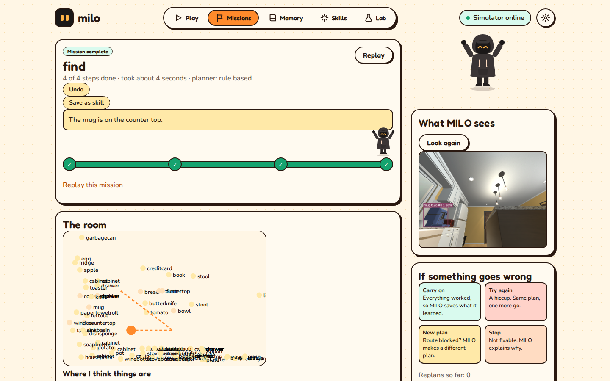
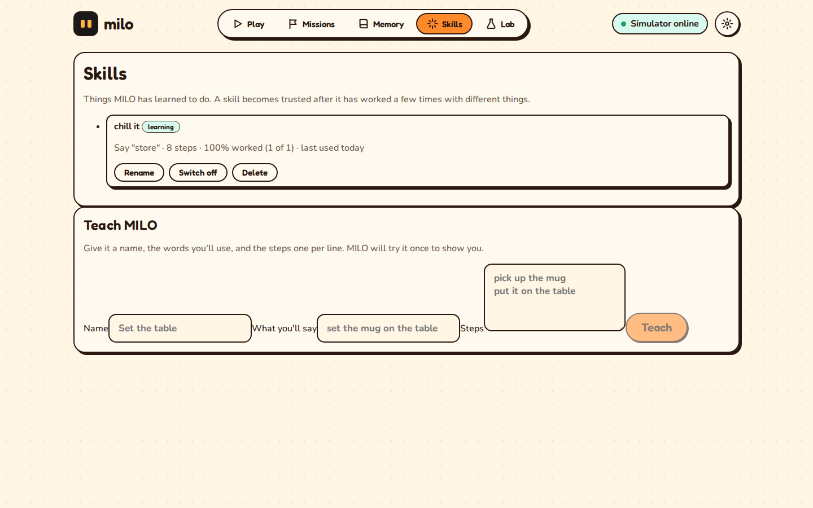
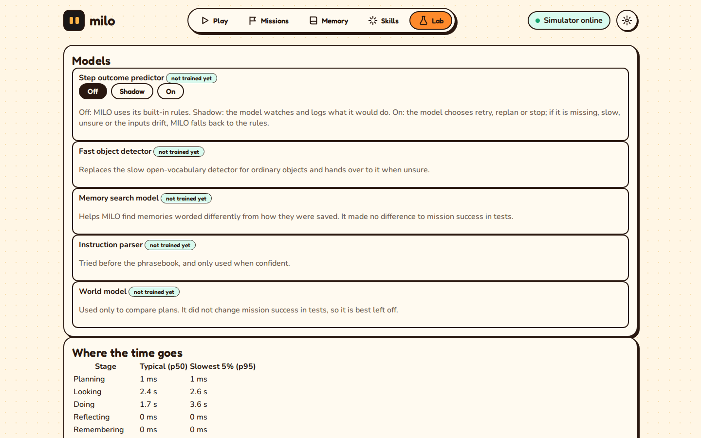

# MILO: a household robot you can talk to, teach and trust

**Memory Integrated Language-Oriented Robot.** MILO takes plain-language requests ("put the apple in the fridge", "is the fridge open?", "chill the tomato") and carries them out in a simulated home ([AI2-THOR](https://ai2thor.allenai.org/)). When it hasn't been programmed for a task, it works out a plan, checks it before acting, and asks before anything risky. It then checks the result against the world and saves what worked as a reusable skill.

*The Play page, captured on 2026-11-25 from the real app running against AI2-THOR.*

## Quick start

| What you want | Command |
|---|---|
| **See it in 60 seconds, no backend** (recorded missions, replays, leaderboard) | `cd frontend && npm ci && VITE_DEMO=1 npm run dev`, then open http://localhost:5173 (or add `?demo=1` to any URL) |
| **The whole app**, one command | `docker compose up --build`, then open http://localhost:8080 |
| Backend and frontend separately (Python 3.9, Node 20) | `cd backend && pip install -r requirements.txt && uvicorn api.app:app --reload`; then `cd frontend && npm install && npm run dev` |
| Real AI2-THOR (needs a GPU and a display) | set `VISION_ENABLE_SIMULATOR=true` in `backend/.env` (copy `backend/.env.example`) |
| Run the benchmark | `make benchmark` (CI gate: `make benchmark-ci`) |
| Regenerate these screenshots | `make screenshots` |

Live demo link: not deployed yet.

## What MILO does

- **Understands plain requests.** It covers fetch, deliver, put in/on, open/close, turn on/off, find, clear a table and tidy up. Questions ("where is the mug?") are answered without moving. A phrasebook and an optional learned parser run first; a language model is only consulted for wording neither knows.
- **Works out new tasks.** For a request it has no recipe for, it reuses a saved skill if one matches, otherwise asks a language model for a plan. Every plan is validated before acting: registry actions only, objects that exist, a step budget, and a symbolic dry run. Risky steps need your approval. See [novel tasks](docs/novel_tasks.md).
- **Learns skills.** You can save a successful mission as a skill, or teach one in words ("pick up the mug", "put it on the table"). Skills can call other skills, up to 3 levels deep. See [skills](docs/skills.md).
- **Asks instead of guessing, and can undo.** "Which mug?" comes with tappable choices, and risky steps wait for approve or skip. Undo plays the inverse actions. See [oversight](docs/oversight.md).
- **Checks its work.** Success conditions (held, in the fridge, door closed, light on) are read from the simulator after every mission. See [foundation](docs/foundation.md).
- **Recovers mid-mission.** If it can't see or reach something, it looks around or re-approaches before retrying or replanning.
- **Has memory you can trust.** Every memory carries a source, a confidence, decay and quarantine; you can pin, fix, set aside or forget memories, and failed missions leave lessons. See [memory trust](docs/memory_trust.md).
- **Shows its working.** Mission traces, replay with a timeline, per-stage timings (p50/p95), a scene map and a downloadable report. See [observability](docs/observability.md).
- **Voice.** It uses the browser's own speech recognition and synthesis, with a fallback to recorded audio. See [voice](docs/voice.md).
- **Learned models, all optional.** A step-outcome predictor, a fast detector, a memory embedder, an instruction parser and a world model. All are off by default and fall back to the rules. See [models](docs/models/README.md).

## How it fits together

Backend: Python 3.9, FastAPI, Pydantic, SQLite, AI2-THOR, Grounding DINO, SAM2, PyTorch (CUDA), scikit-learn. Frontend: React and TypeScript on Vite, with live updates over SSE and polling as a fallback. Tests: pytest, Vitest and Playwright. Deployment: Docker Compose with nginx. CI: GitHub Actions (backend, frontend, browser end-to-end, Docker build, and a benchmark regression gate).

## Screenshots

All captured on 2026-11-25 from the real app, after real missions on AI2-THOR. Regenerate them with `make screenshots`.

| Missions: a finished "find the mug" mission, MILO's camera view with the detection, and the room map | Replay: step through what MILO saw, planned and thought |
|---|---|
|  |  |

| Memory: what MILO remembers, where it came from and how sure it is | Skills: a mission saved as a skill, and the teach form |
|---|---|
|  |  |

| Leaderboard: every planner on the fixed benchmark | Lab: model switches and where the time goes |
|---|---|
|  |  |

In the Lab screenshot, every model reads "not trained yet". That's because trained model files aren't stored in git; train them with the `make` targets in [models](docs/models/README.md).

| Phone | Demo mode (no backend) |
|---|---|
|  |  |

*Demo mode replays recorded missions with no simulator or GPU. Its "camera" panel shows a schematic sketch, not a real frame.*

## Results

Unless a row says otherwise, everything was measured on 2026-11-25 in the fixed synthetic home with fixed seeds. Each table names the command that reproduces it.

**Tests (2026-11-25):**

- Backend: 1,422 passed, 2 skipped (`cd backend && python -m pytest tests/`). The 2 skipped tests need a live LLM key.
- Frontend: 215 passed in 37 files (`npm test`).
- Playwright: 7 passed (`npx playwright test`).
- black, ruff, mypy, tsc and eslint report no errors.

**Benchmark** (`make benchmark`: 23 known tasks, 8 new tasks, and every known task under 6 fault kinds):

| Planner | Known tasks | New tasks | Under faults | Steps | Sim time (s) |
|---|---|---|---|---|---|
| rule-based | 100% | 0% | 78% | 7.52 | 12.5 |
| behaviour tree | 100% | 0% | 78% | 5.63 | 9.88 |
| HTN | 100% | 0% | 78% | 5.63 | 9.88 |
| ReAct | not measured (needs a model) | | | | |
| novel planner (reference plans) | not run | 100% | not run | 5.25 | 9.38 |

- **ReAct:** without a language model it falls back to the rule-based planner, so its benchmark row would only repeat rule-based.
- **Behaviour tree and HTN:** their rows are genuinely identical. Checked plan by plan, all three classical planners produce the same first plan on all 23 known tasks.
- **Rule-based:** executes more steps per mission (5.83 vs 4.43 on known tasks), so the difference arises during execution, not in the first plan. The cause hasn't been traced yet.

**Recovery by fault kind** (before → after in-mission recovery):

| Blocked path | Out of reach | Stuck door | Timeout | Wrong detection | Missing object |
|---|---|---|---|---|---|
| 100% | 22% → **100%** | 100% | 100% | 4% → **83%** | 0% |

**Ablations** (rule-based, known tasks + faults):

| Variant | Success |
|---|---|
| everything on | 81% |
| no memory | 81% |
| no reflection | 21% |
| no replanning | 21% |
| no in-mission recovery | 57% |

Saved skills turn a repeated new task from 1 model call into 0.

**New tasks** (`python -m novel.eval_novel`; 60 held-out commands):

| Plan source | Correct |
|---|---|
| before (unknown tasks refused) | 0 / 60 |
| offline (no model) | 0 / 60 |
| reference plans (upper bound for the pipeline, not a model result) | 60 / 60 |
| Claude | **not measured**: no API credits |

- All 10 deliberately bad plans were caught before acting, and 0 unsafe actions were executed.
- The Claude path is in the code but has never been run against the API.

**Memory poisoning** (`python -m memory.eval_trust`): "put it away" correct under a 100% attack rate, defence off → on:

| Attack | Off → on |
|---|---|
| imported preference | 0% → **100%** |
| fake imported skills | 0% → **100%** |
| spoofed "user" preference | 0% → **0%** (not defended) |

**Failure memory:** with a persistent "can't see it" fault, repeat attempts went from 0% to **100%**. Out-of-reach failures, which have no known fix, are unchanged.

**Goal checks** (`python -m verification.eval_goal_check`): the world contradicted 3 of 213 reported successes. All 3 were "find" tasks under a wrong detection.

**Learned models** (details and model cards in [docs/models](docs/models/README.md)):

| Model | Baseline | Learned | Verdict |
|---|---|---|---|
| Step outcome predictor | rules: AUROC 0.661; mission success 0.717 | AUROC 0.968, ECE 0.005; success 0.783, wasted steps 1.94 → 1.22 | Better (synthetic simulator only) |
| Fast detector (YOLO11n, real AI2-THOR frames) | Grounding DINO: mAP@0.5 0.315, 547 ms | mAP@0.5 0.548, 5.9 ms; observe time 1.37 s → 0.068 s | Better |
| Memory embedder | hashing: recall@5 0.606 | 0.9997 | Better retrieval, no effect on missions (0.72 both) |
| Instruction parser | phrasebook: 0.137 exact on new wording | 0.647 (learned first) | Better on new wording |
| World model | static plan scoring | plan-score AUROC 0.525 → 0.552 | No mission gain (0.70 both); leave off |

**Earlier results on real AI2-THOR** (`milo_benchmark` [v1.0 and v1.1](https://huggingface.co/datasets/naishashetty/milo_benchmark), August 2026, scored against live simulator state). These come from before the work above and weren't re-run:

| Planner | v1.0 (25 tasks, 5 scenes) | v1.1 (54 tasks, 9 scenes) |
|---|---|---|
| rule-based | 24/25 (96%) | 50/54 (92.6%) |
| behaviour tree | 24/25 (96%) | 50/54 (92.6%) |
| HTN | 24/25 (96%) | 43/45 (95.6%), multi-step tier not attempted |
| ReAct with `qwen2.5:7b` (local, via Ollama) | 20/25 (80%) | 36/54 (66.7%) |

The companion leaderboard and episode replay are in the [Hugging Face Space](https://huggingface.co/spaces/naishashetty/milo_benchmark_companion).

## What didn't beat its baseline

- **Spoofed "user" memories aren't defended.** A fake memory claiming to come from you wins, just as a real change of mind would.
- **Memory adds nothing on the current benchmark**, where every object is in view.
- **The world model and the memory embedder** didn't change mission success.
- **No language-model result for new tasks.** The 60/60 comes from hand-written reference plans, so it measures the pipeline, not a model's planning. Claude was never run.
- **Wrong detection on "find" tasks** is caught only by the final goal check, not within the mission.
- **The synthetic simulator.** Except for the detector and the earlier v1.0/v1.1 runs, everything was measured there, not in real AI2-THOR.

## Configuration

Copy `backend/.env.example` to `backend/.env`. Everything has a safe default.

| Setting | Default | What it does |
|---|---|---|
| `EXECUTION_STEP_TIMEOUT_S` | `120` | A hung simulator call fails its step after this many seconds (`0` = no timeout) |
| `VISION_ENABLE_SIMULATOR` | `false` | Start real AI2-THOR (needs a GPU and a display) |
| `LANGUAGE_LLM_PROVIDER` | `openai` | Model for unrecognised wording: `openai`, `gemini` or `qwen` (any local OpenAI-compatible server, such as Ollama) |
| `MILO_NOVEL_PROVIDER` | `claude` | Planner for new tasks; falls back to `offline` when no key is set |
| `MILO_GOAL_CHECK` | `report` | `enforce` turns a failed success check into a replan |
| `MILO_INMISSION_RECOVERY` | `1` | Look around or re-approach before retrying |
| `MILO_MEMORY_DEFENCE` | `1` | Trust-weighted memory, quarantine and reconciliation |
| `MILO_FAILURE_MEMORY` | `1` | Learn lessons from failed missions |
| `MILO_APPROVALS`, `MILO_APPROVAL_TIMEOUT` | `1`, `300` | Ask before risky steps; no answer means skip |
| `API_KEY`, `RATE_LIMIT_PER_MINUTE` | unset | Require an `X-API-Key` header; rate-limit per caller |
| `MILO_LEARNED_REFLECTOR`, `MILO_FAST_DETECTOR`, `MILO_LEARNED_PARSER`, `MILO_WORLD_MODEL` | off | The learned models (see [models](docs/models/README.md)) |

Never commit `backend/.env` or any key.

## Documentation

- Write-up: [docs/writeup.md](docs/writeup.md)
- The parts: [foundation](docs/foundation.md) · [novel tasks](docs/novel_tasks.md) · [skills](docs/skills.md) · [oversight](docs/oversight.md) · [memory trust](docs/memory_trust.md) · [benchmark and CI](docs/benchmark.md) · [observability](docs/observability.md) · [voice](docs/voice.md) · [learned models](docs/models/README.md)
- Running the tests: [docs/testing/running_tests.md](docs/testing/running_tests.md)
- Docker and deployment: [docker/README.md](docker/README.md) · [deployment/README.md](deployment/README.md)
- Older design notes and phase history: [docs/](docs/)

## What's left

1. Measure new tasks with a real language model. Claude needs API credits; a free local model (Ollama) is the next option.
2. Run the outcome predictor on real AI2-THOR before switching it on by default.
3. Defend against spoofed "user" memories: assign each memory's source on the server and log who changed it.
4. Recover "find" tasks under a wrong detection within the mission, by taking a second look.
5. Add benchmark tasks that genuinely need memory, so the memory ablation means something.
6. Deploy demo mode as a free static site, and add the link here.
7. Move off Python 3.9, which is nearing end of life.

## License

MIT. See [LICENSE](LICENSE).
