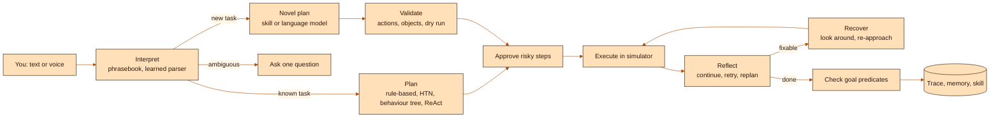
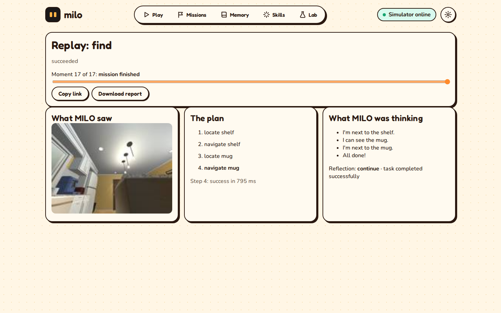
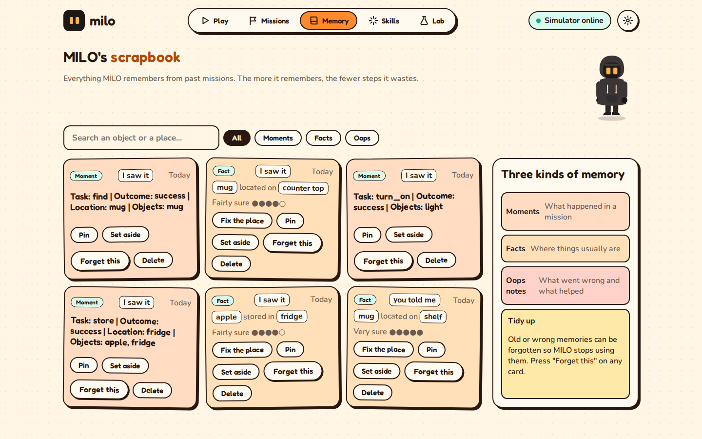
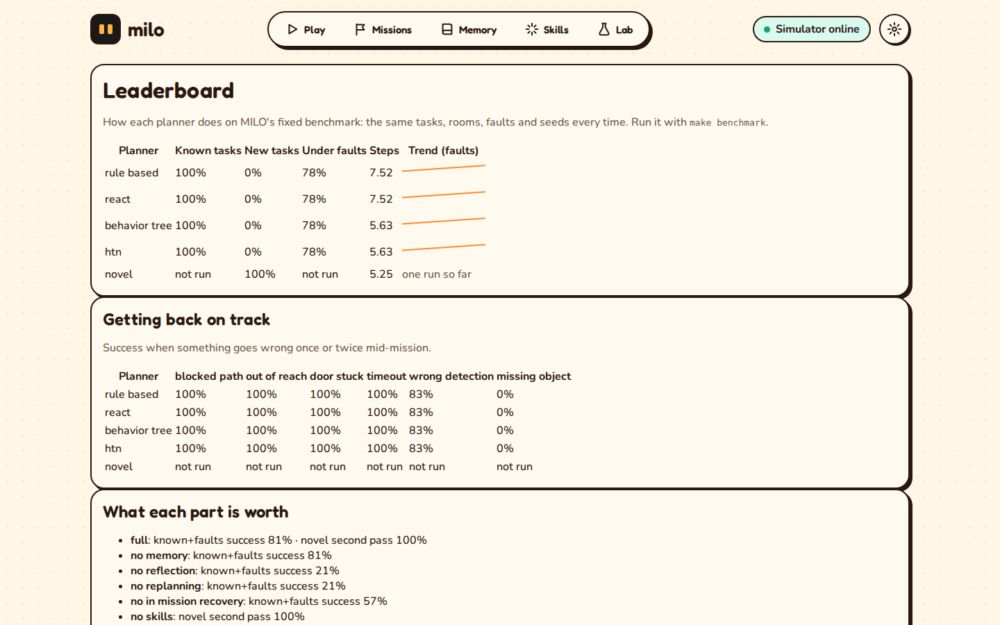
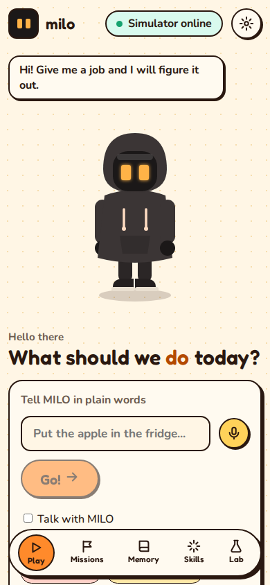
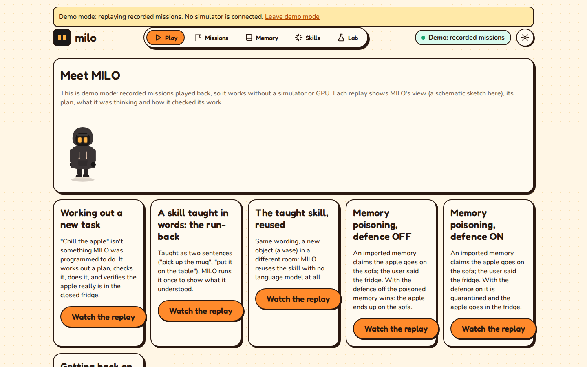

# MILO

**A household robot you talk to in plain language, which works out jobs it was never programmed for.**

MILO (Memory Integrated Language-Oriented Robot) takes requests like "put the apple in the fridge" or "is the fridge open?" and carries them out in a simulated home built on [AI2-THOR](https://ai2thor.allenai.org/). What sets it apart:

- It works out tasks it wasn't programmed for, and checks every plan before acting.
- It asks before risky steps.
- It checks the result against the simulated world rather than trusting itself.
- It saves what worked as a reusable skill.

It is a research and engineering platform for people working on embodied agents, planning, and agent memory and safety. Every part can be swapped, tested and measured on its own.

**Contents:** [What we addressed](#what-we-addressed) · [Research opportunities](#research-opportunities) · [Architecture](#architecture) · [Tech stack](#tech-stack) · [How to use it](#how-to-use-it) · [Results](#results) · [Datasets and demo](#datasets-and-demo-hugging-face) · [Screenshots](#screenshots) · [Licence](#licence)

## What we addressed

| Problem | What we did | Measured result |
|---|---|---|
| A hung simulator call froze the whole mission | Steps time out (default 120 s, `EXECUTION_STEP_TIMEOUT_S`); retries and replans skip steps the world already shows as done | A hung call now fails its step at the timeout. Tests cover this (`tests/test_step_timeout_default.py`) |
| SAM2 encoded the same image again for every object | All of a frame's boxes in one SAM2 call | Masks per frame 487 ms → 127 ms (p95 1,411 → 160 ms) on an RTX 4050, identical masks ([perception profile](docs/perception_profile.md), 2026-11-26) |
| Perception was slow inside the planning loop | Cheap observation (no SAM2 masks) while planning, full pipeline only in the Vision panel; an optional fast YOLO11n detector that hands over to Grounding DINO when unsure | Observe time per mission 1.37 s → 0.068 s on real AI2-THOR, success unchanged at 0.90 ([fast detector card](docs/models/fast_detector.md), 2026-11-24) |
| Memory search slowed down as memories grew | In-memory vector index loaded once, batched writes, indexed lookups | At 5,000 memories, search went from 26.7 ms to 3.8 ms (7×) (`pytest tests/test_memory_scaling_benchmark.py -s`, 2026-11-25) |
| Unknown requests were refused | A novel-task planner: reuse a saved skill, otherwise ask a language model, validate the plan, then act; successes become skills | All 10 deliberately bad plans caught before acting; 0 unsafe actions run ([novel tasks](docs/novel_tasks.md)) |
| Trust and safety | Plan validation, a constraints file, approval before risky steps (no answer means skip), "which one?" questions, undo | Covered by tests ([oversight](docs/oversight.md)); no benchmark number |
| No visibility into what the robot did | A trace store for every mission, with replay, p50/p95 timings per stage, a scene map and a downloadable report | Tracing costs about 2.4 ms per mission ([foundation](docs/foundation.md)) |
| A blocked way to a place stalled the mission for good | After a second "blocked" failure, MILO uses another place of the same kind (the other shelf) and remembers the blocked one for next time | Competing-routes tier 0% → 100% for every planner; the next mission avoids it before acting ([benchmark](docs/benchmark.md), 2026-11-26) |
| Impossible requests ("pick up the fridge") were reported as successes in the synthetic home | The simulator refuses what AI2-THOR refuses, and MILO checks a plan against what each object can do before acting | Impossible tier 0% → 83%: 5 of 6 refused with no action; the missing object can't be judged ([benchmark](docs/benchmark.md), 2026-11-27) |
| No way to tell whether a change made it worse | A fixed, seeded benchmark over every planner, plus a CI gate that fails if a planner drops more than 5 points | The regression suite (153 missions per planner) and five harder tiers run in about 35 s ([benchmark](docs/benchmark.md), 2026-11-26) |

## Research opportunities

These are open directions MILO makes it possible to study. They aren't claims of new results.

| Direction | The question | What MILO already provides |
|---|---|---|
| Memory poisoning and provenance | How should an agent weigh memories by source, and how can it tell a spoofed "user" memory from a real change of mind? | Memory sources, decay and quarantine, plus a red-team evaluation (`make eval-trust`). Imports can't claim to be the user; someone else speaking to MILO directly is the documented open gap |
| Learned step-outcome prediction | When should an agent abort, retry or replan, judged by predicted outcome rather than fixed rules? | An episode logger, a fault-injecting simulator, a calibrated outcome model, and a shadow mode for comparing it against the rules |
| Unseen tasks and skill libraries | How far can validated plans plus a growing skill library carry an agent beyond its programmed tasks? | The novel-task pipeline, 60 held-out commands, and skill chaining with a trust threshold |
| In-mission recovery (self-healing) | Which failures can be repaired within the mission, and which need a new plan? | Six injectable fault kinds and per-fault recovery rates, with recovery behind its own switch |
| World models for checking plans | Can predicting the next state catch a failing plan before it runs? | A transition model and rollout plan scoring. It didn't help yet, because the planners never disagree in the synthetic home |
| Fault-tolerant planning benchmarks | How do planners compare when the world pushes back? | The fixed benchmark with faults, ablations and a CI gate, plus the [Hugging Face dataset](https://huggingface.co/datasets/naishashetty/milo_benchmark) |
| Synthetic simulator to real AI2-THOR to real robots | How much of what works in the synthetic home holds up in AI2-THOR, and then on hardware? | The same orchestrator runs on both the synthetic simulator and AI2-THOR; the detector was trained and tested on real AI2-THOR frames |

## Architecture

**One mission, end to end:**

1. **Interpret.** "Put the apple in the fridge" is matched to a known task by the phrasebook (or the optional learned parser). A request it can't match goes to the novel planner, and an ambiguous one ("the mug" when there are two) gets one question.
2. **Plan.** The chosen planner writes the steps. For a new task, the novel planner first tries a saved skill, then a language model. The plan is validated before anything moves: registry actions only, objects that exist, a step budget, a symbolic dry run.
3. **Approve and execute.** Risky steps wait for your approval, and the rest run in the simulator.
4. **Reflect and recover.** After each failure, reflection picks continue, retry or replan. In-mission recovery looks around, re-approaches, or switches to another place of the same kind when the way to one is blocked.
5. **Check and save.** At the end, goal predicates (held, in the fridge, closed) are read from the world. The mission's trace is saved for replay, memory records what was learned, and a success can be saved as a skill.

| Module (`backend/`) | Owns | Doc |
|---|---|---|
| `language/` | Turning requests into tasks, questions or preferences | [Overview](docs/application/overview.md) |
| `planner/` | Classical planners and the action registry | [Planning](docs/architecture/planning.md) |
| `novel/` | New tasks: providers, validation, constraints, skills | [Novel tasks](docs/novel_tasks.md), [Skills](docs/skills.md) |
| `orchestration/` | The mission loop, reflection and in-mission recovery | [Architecture](docs/application/architecture.md) |
| `oversight/` | Questions, approvals, plan preview, undo | [Oversight](docs/oversight.md) |
| `execution/`, `verification/` | Running steps; success predicates | [Foundation](docs/foundation.md) |
| `memory/` | Memory store, trust, quarantine, lessons | [Memory trust](docs/memory_trust.md) |
| `tracelog/` | Mission traces, timings, reports | [Observability](docs/observability.md) |
| `benchmark/` | Fixed suite, ablations, CI gate | [Benchmark](docs/benchmark.md) |
| `learning/`, `vision/` | Learned models, detection, segmentation | [Models](docs/models/README.md) |
| `api/` | FastAPI routes, including SSE streams | [API contracts](docs/architecture/api_contracts.md) |

## Tech stack

| Area | What's used |
|---|---|
| Backend | Python 3.9, FastAPI, Pydantic 2, Uvicorn |
| Simulation and vision | AI2-THOR 5.0.0, Grounding DINO, SAM2, PyTorch (CUDA), OpenCV |
| ML | scikit-learn, Ultralytics YOLO11n exported to ONNX (`requirements-ml.txt`), Hugging Face Transformers |
| Memory and storage | SQLite with an in-memory vector index |
| Frontend | React 18, TypeScript 5, Vite 5, React Router 6 |
| Testing | pytest, Vitest 2, Testing Library, Playwright 1.62 |
| CI and deployment | GitHub Actions, Docker Compose, nginx 1.27 |

## How to use it

**Prerequisites:**

- Python 3.9 and Node 20.
- Docker, for the one-command setup.
- A GPU and a display, only if you want real AI2-THOR.

**Quick start:**

1. **Demo mode, no backend:** `cd frontend && npm ci && VITE_DEMO=1 npm run dev`, then open http://localhost:5173. It replays recorded missions, so it needs no simulator or GPU. You can also add `?demo=1` to any URL.
2. **The whole app with Docker Compose:** `docker compose up --build`, then open http://localhost:8080 (the API is on port 8000).
3. **Backend and frontend separately:**
   - Backend: `cd backend && pip install -r requirements.txt && uvicorn api.app:app --reload`
   - Frontend, in a second terminal: `cd frontend && npm install && npm run dev`
4. **Real AI2-THOR:** `cp backend/.env.example backend/.env`, set `VISION_ENABLE_SIMULATOR=true`, and restart the backend. This needs a GPU and a display.

**Things to try on the Play page:**

| Type | What you'll see |
|---|---|
| `put the apple in the fridge` | An 8-step plan (find, walk, pick up, open, place, close), a progress track, and a goal check that the apple is in the fridge and MILO's hand is empty |
| `is the fridge open?` | An answer such as "No, the fridge is closed." MILO doesn't move |
| `the mug goes on the shelf` | "Got it ... I'll remember." The preference shows up on the Memory page as "you told me" |
| `chill the tomato` | A new task. With a language model set up, MILO works out a plan, validates it, and asks before risky steps. Without one, it says "I can't work out new tasks offline", unless a saved skill matches |

**Configuration.** Copy `backend/.env.example` to `backend/.env`. These are the settings most people need; the full list with comments is in [`backend/.env.example`](backend/.env.example) and [configuration and providers](docs/phases/phase8_5_configuration_and_providers.md).

| Setting | Default | What it does |
|---|---|---|
| `VISION_ENABLE_SIMULATOR` | `false` | Start real AI2-THOR |
| `EXECUTION_STEP_TIMEOUT_S` | `120` | Seconds before a hung simulator call fails its step (`0` = no timeout) |
| `LANGUAGE_LLM_PROVIDER` | `openai` | Model for wording MILO doesn't recognise: `openai`, `gemini` or `qwen` (a local OpenAI-compatible server such as Ollama) |
| `MILO_NOVEL_PROVIDER` | `claude` | Planner for new tasks. Without Anthropic credentials it falls back to `offline` |
| `MILO_GOAL_CHECK` | `report` | `enforce` turns a failed goal check into a replan |
| `MILO_INMISSION_RECOVERY` | `1` | Look around or re-approach before retrying |
| `MILO_MEMORY_DEFENCE` | `1` | Weigh memories by source, quarantine suspicious imports |
| `API_KEY`, `RATE_LIMIT_PER_MINUTE` | unset | Require an `X-API-Key` header; rate-limit per caller |

**Tests and benchmark:**

| What | Command |
|---|---|
| Backend tests | `cd backend && python -m pytest tests/` |
| Frontend tests and lint | `cd frontend && npm test && npm run lint` |
| Browser tests | `cd frontend && npm run test:e2e` |
| Full benchmark | `make benchmark` (writes `benchmarks/latest.json` and `latest.md`) |
| CI regression gate | `make benchmark-ci` |
| README numbers check | `python scripts/check_readme_numbers.py` |

**Troubleshooting:** [docs/troubleshooting.md](docs/troubleshooting.md) covers Docker, AI2-THOR and the simulator, LLM credentials, speech, frontend-to-backend connectivity and the browser tests.

## Results

All benchmark numbers come from `benchmarks/latest.json` (`make benchmark`, run on 2026-11-25). That's a fixed synthetic home with fixed tasks, faults and seeds, so repeated runs give identical numbers. `python scripts/check_readme_numbers.py` fails if this section drifts from that file.

**Benchmark** (23 known tasks, 8 new tasks, and every known task under 6 fault kinds):

| Planner | Known tasks | New tasks | Under faults | Steps per mission |
|---|---|---|---|---|
| rule-based | 100% | 0% | 78% | 7.52 |
| behaviour tree | 100% | 0% | 78% | 5.63 |
| HTN | 100% | 0% | 78% | 5.63 |
| novel planner, **reference plans** | not run | 100% | not run | 5.25 |

- **New tasks:** the classical planners refuse them, hence 0%. The novel planner's 100% uses hand-written reference plans, so it measures the pipeline, not a model.
- **ReAct** (measured separately: `qwen2.5:7b` via Ollama, one run, `results/react_local/benchmark.md`): 100% known, 0% new tasks, 80% under faults, but in 99 of 179 cases it handed the plan to rule-based after an unusable answer or hitting its 12-step limit. The model alone succeeds on 13 of 23 known tasks, 0 of 8 new tasks and 0 of 26 harder-tier cases.
- **Behaviour tree and HTN:** identical because all three classical planners produce the same first plan on every known task. Rule-based executes more steps; the cause hasn't been traced.

**Recovery by fault kind** (rule-based; before → after in-mission recovery):

| Blocked path | Out of reach | Stuck door | Timeout | Wrong detection | Missing object |
|---|---|---|---|---|---|
| 100% | 22% → 100% | 100% | 100% | 4% → 83% | 0% |

**Ablations** (rule-based, known tasks plus faults):

| Variant | Success |
|---|---|
| everything on | 81% |
| no memory | 81% |
| no reflection | 21% |
| no replanning | 21% |
| no in-mission recovery | 57% |

**Learned models** (all off by default; details in the [model cards](docs/models/README.md); trained 2026-11-24):

| Model | Baseline | Learned | Verdict |
|---|---|---|---|
| Step outcome predictor | rules: AUROC 0.661; success 0.717 | AUROC 0.968, ECE 0.005; success 0.783, wasted steps 1.94 → 1.22 | Better, synthetic simulator only |
| Fast detector (real AI2-THOR frames) | Grounding DINO: mAP@0.5 0.315, 547 ms | mAP@0.5 0.548, 5.9 ms | Better |
| Memory embedder | hashing: recall@5 0.606 | recall@5 0.9997 | Better retrieval; finds places remembered under other names: 7 of 8 missions vs 6 of 8 (2026-11-26) |
| Instruction parser | phrasebook: 0.137 exact on new wording | 0.647 exact | Better on new wording |
| World model | static plan scoring | plan-score AUROC 0.525 → 0.552 | No mission gain (0.70 both) |

**New tasks** (`make eval-novel`, 60 held-out commands, [details](docs/novel_tasks.md)):

| Plan source | Correct |
|---|---|
| before (unknown tasks refused) | 0 / 60 |
| offline, no model | 0 / 60 |
| qwen2.5:7b (Q4_K_M, local via Ollama), prompt v2 (3 runs, 2026-11-26) | 44 / 60 (73.3%, spread 0) |
| **qwen2.5:7b, prompt v3: decides plan / ask / refuse first (`make novel-eval`, 3 runs, 2026-11-26)** | **48-49 / 60** (80.6%, spread 1.7 pts) |
| reference plans (pipeline upper bound) | 60 / 60 |
| Claude | not measured (no API credits) |

- **With qwen2.5:7b, prompt v3:**
  - new combinations: 29-30/30; compositions: 13/15; 0 unsafe actions run; 11.1 s per task.
  - It still rarely asks: 2 of 8 ambiguous commands (0 with v2). It refuses 4 of 7 impossible ones (1 with v2). In the app a model-made plan is shown for approval before it runs.
  - v3 was tuned on the DEV set only; TEST was run once afterwards.
- **Skills** (same model): repeating a command drops from 1.3 to 0.2 model calls and from 8.6 to 1.5 s, and 90% transfer to another object. Composing two learned skills saves nothing yet.
- On the benchmark's known tasks (one run, 2026-11-27): 17 of 23, and it refuses all 6 impossible requests. Its misses are its own plans: "bring me the apple" carried to a "user" that doesn't exist, and impossible success conditions for "find" ([benchmark](docs/benchmark.md)).
- The model was chosen on a separate DEV set from four candidates ([local model](docs/local_model.md)).

**Memory poisoning** (`make eval-trust`; missions correct at a 100% attack rate, defence off → on):

| Attack | Off → on |
|---|---|
| imported preference | 0% → 100% |
| fake imported skills | 0% → 100% |
| spoofed "user" preference (an import claiming to be from you) | 0% → 100% |
| someone else telling MILO directly | 0% → 0% |

**Failure memory** ([memory trust](docs/memory_trust.md)): first measured, a persistent "can't see it" fault went 0% → 100% on the repeat attempt. Since in-mission recovery was added, the first attempt already succeeds, so failure memory no longer changes the result. Out of reach, which has no known fix, stays at 0%.

**Goal checks** (`make eval-goal-check`, 300 held-out missions): the world contradicted 3 of 213 reported successes. All 3 were "find" tasks under a wrong detection.

**What did not beat its baseline:**

- **Someone else telling MILO directly** isn't defended: MILO can't tell who is speaking, so it looks like a change of mind. (Imports that only *claim* to be from you are now quarantined.)
- **Memory ablation on the regression tier:** turning memory off changes nothing there (81% both), because every object is in view. On the memory tier it is 100% → 0% ([benchmark](docs/benchmark.md)).
- **The world model** didn't change mission success. Competing routes are fixed by in-mission recovery and memory instead.
- **Asking with a local model.** qwen2.5:7b with prompt v3 asks on only 2 of 8 ambiguous commands (refusing improved to 4 of 7). Claude was never run (no API credits).
- **The synthetic simulator.** Except for the detector and the Hugging Face v1.0 and v1.1 results below, everything was measured there, not in real AI2-THOR.

## Datasets and demo (Hugging Face)

- **Dataset:** [naishashetty/milo_benchmark](https://huggingface.co/datasets/naishashetty/milo_benchmark). It holds versions v1.0 (25 tasks, 5 scenes) and v1.1 (54 tasks, 9 scenes), scored against live AI2-THOR state in August 2026. It predates the benchmark above and does not yet include it.
- **Space (leaderboard and episode replay):** [naishashetty/milo_benchmark_companion](https://huggingface.co/spaces/naishashetty/milo_benchmark_companion). It shows the v1.0 and v1.1 results, including ReAct with a local `qwen2.5:7b` model (20/25 on v1.0, 36/54 on v1.1).

## Screenshots

Captured on 2026-11-25 with Playwright from the real app after real missions on AI2-THOR, at 1440×900 (desktop) and 390×844 (phone). Regenerate them with `make screenshots`.

| | |
|---|---|
|  **Play:** tell MILO a job. |  **Missions:** a finished mission, MILO's camera view and the room map. |
|  **Replay:** step through what MILO saw, planned and thought. |  **Memory:** what MILO remembers, where it came from, how sure it is. |
|  **Skills:** a mission saved as a skill, and teaching in words. |  **Leaderboard:** the fixed benchmark in the app. |
|  **Lab:** model switches and per-stage timings. Models read "not trained yet" because trained files aren't in git. |  **Phone:** the same app with a bottom tab dock. |
|  **Demo mode:** recorded missions, no backend. |  **Demo replay:** the camera panel is a schematic sketch in demo mode. |

## Licence

MIT. See [LICENSE](LICENSE).
